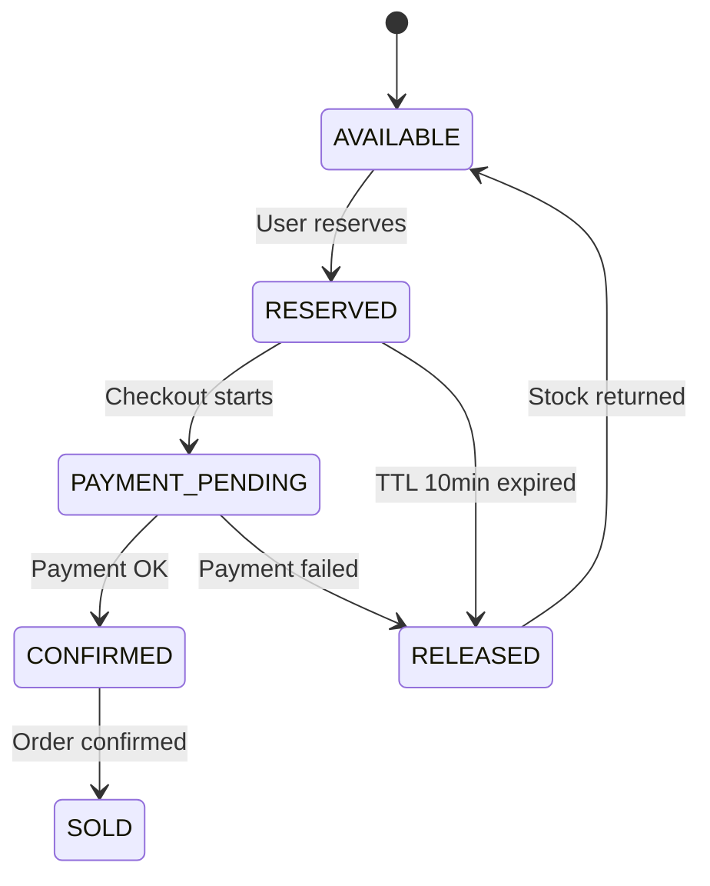

# SALESTORM — Presentation Outline
## Flash Sale System Design | Hackathon Submission

---

## Slide 1 — Title

**SALESTORM**  
*Designing a Zero-Oversell Flash Sale Platform for 10,000 Concurrent Users*

> Team: [Your Team Name]  
> Date: 2026-10-05

---

## Slide 2 — Problem Statement

> **Challenge:** 10,000 users compete for 100 units at exactly T=0.

Key failure modes to prevent:
- ❌ Oversell (more sold than stock)
- ❌ Double charge (payment retried twice)
- ❌ Ghost reservations (stock held forever by abandoned carts)
- ❌ Cascade failure (payment gateway goes down → whole site dies)

---

## Slide 3 — Traffic Flow (One Line)

```
CDN/WAF (Waiting Room + Rate Limit)
  → Load Balancer
  → API Gateway (JWT Auth)
  → Sale → Inventory → Reservation
  → Checkout → Payment
  → Order → Shipment + Notification
```

Visual: Show the container diagram from 02_HLD.

---

## Slide 4 — The Inventory Problem & Solution

**Problem:** 10,000 simultaneous DB writes → lock contention → timeouts

**Solution: Two-phase gate**

| Phase | Technology | Role |
|-------|-----------|------|
| Fast gate | Redis Lua atomic decrement | Reject 99%+ in < 1ms |
| Source of truth | SQL `WHERE available >= 1` | Guarantees no oversell |
| Rollback | Redis INCR if SQL fails | Keeps Redis in sync |

> "Redis is fast. SQL is correct. We use both."

---

## Slide 5 — Reservation Lifecycle



**Key:** Expiry sweeper runs every 30s — no stock held hostage.

---

## Slide 6 — Payment Resilience

**Three layers of safety:**

1. **Idempotency Key** `SHA256(customer+sale+product)` → no double charge on retry
2. **Circuit Breaker** → fail-fast on gateway outage; 30s cooldown
3. **Timeout Reconciler** → 5-min job resolves stuck payments via gateway query

**Async confirmation** via Transactional Outbox → SQS:
```
Payment DB commit + outbox_event (atomic)
  → Outbox Worker → SQS → Order Service → Shipment + Notification
```

---

## Slide 7 — Order Lifecycle

```
CREATED → PAYMENT_PENDING → CONFIRMED
       → PROCESSING → SHIPPED
       → OUT_FOR_DELIVERY → DELIVERED
```

Driven by **choreography Saga** — each service reacts to events.  
No central orchestrator; compensating actions on failure.

---

## Slide 8 — Scalability Numbers

| Component | Capacity | Notes |
|-----------|----------|-------|
| CDN | Unlimited | Cloudflare absorbs DDoS |
| API Gateway | 10k RPS | ECS horizontal scale |
| Redis | 300k ops/sec | ElastiCache cluster mode |
| PostgreSQL | 2k TPS writes | RDS Multi-AZ + read replicas |
| SQS | Infinite | Managed |

Peak burst: **2,000 reservation attempts/sec** → handled comfortably.

---

## Slide 9 — Security Highlights

| Layer | Measure |
|-------|---------|
| Edge | WAF rules, DDoS protection, waiting room |
| API | JWT RS256, RBAC, HTTPS/TLS 1.3 |
| Data | AES-256 at rest, tokenized payments (no PCI scope) |
| Ops | AWS Secrets Manager, audit logs |

Rate limits: 100 req/min/IP globally; 5/min/user on reserve.

---

## Slide 10 — Observability

**Three pillars:**
- 📊 **Metrics** — CloudWatch/Grafana dashboards; alert on circuit breaker OPEN, DLQ depth > 0
- 🔍 **Tracing** — OpenTelemetry; 100% sampling during sale window
- 📝 **Logs** — Structured JSON; trace_id on every log line

**Key dashboards:**
1. Live sale: stock countdown + reservation rate
2. Payment health: success/fail/timeout + circuit state
3. Infra: CPU, DB connections, Redis memory

---

## Slide 11 — Design Patterns Used

| Pattern | Purpose |
|---------|---------|
| Circuit Breaker | Payment gateway resilience |
| Transactional Outbox | At-least-once async events |
| Idempotent Consumer | Dedup SQS messages |
| Repository | Testable data access |
| Strategy | Pluggable payment/notification providers |
| Saga (Choreography) | Distributed transaction without 2PC |
| Waiting Room | Smooth burst traffic |

---

## Slide 12 — SOLID in Practice

| Principle | Key Example |
|-----------|-------------|
| **S**ingle Responsibility | `ExpirySweeper` only sweeps; `PaymentService` only pays |
| **O**pen/Closed | Add Razorpay without touching `PaymentService` |
| **L**iskov | `StripeClient` / `RazorpayClient` fully substitutable |
| **I**nterface Segregation | `IInventoryReader` ≠ `IInventoryWriter` |
| **D**ependency Inversion | `PaymentService` injects `BaseGatewayClient` |

---

## Slide 13 — Simulation Results

**10,000 users | 100 units | Python threading simulation**

| Outcome | Count |
|---------|-------|
| Sold out at Redis gate | ~9,850 |
| Payment success ✅ | ~82 |
| Payment failed → stock released | ~9 |
| Timeout → resolved async | ~8 |
| Sold out at SQL (safety net) | ~1 |

**Result: ✅ Zero oversell. 100% idempotent. Correct under contention.**

---

## Slide 14 — ADR Summary

| ADR | Decision |
|-----|----------|
| 001 | Redis Lua + SQL two-phase inventory gate |
| 002 | Transactional Outbox for at-least-once events |
| 003 | 10-min TTL + 30s expiry sweeper |
| 004 | Circuit breaker + retry + reconciler for payment |
| 005 | SHA256 idempotency key with unique DB constraint |

---

## Slide 15 — Key Takeaways

1. **Zero oversell** — Redis speed + SQL correctness, not a choice between them
2. **No double charge** — Idempotency key enforced at DB and gateway layers
3. **No stuck stock** — TTL + sweeper returns abandoned units in ≤ 40s
4. **Resilient to gateway failures** — Circuit breaker + async reconciliation
5. **Scales horizontally** — Stateless services; all state in Redis + PostgreSQL

> *"Design for the failure case first; the happy path takes care of itself."*

---

## Slide 16 — Q&A

**Anticipated questions:**

**Q: What if Redis and SQL get out of sync?**  
A: Redis is an optimistic gate; SQL is truth. Rollback INCR on SQL fail. Warm-up Redis from SQL on restart.

**Q: What if two users get past Redis but SQL only has 1 unit?**  
A: Conditional UPDATE affects only 1 row; second thread gets 0 rows → rollback Redis. No oversell.

**Q: What about the DLQ — who processes it?**  
A: Ops team monitors DLQ alerts; messages are replayed manually or via automated retry after fix.

**Q: How is the waiting room fair?**  
A: Cloudflare assigns a queue position at first request; position is deterministic per session.
